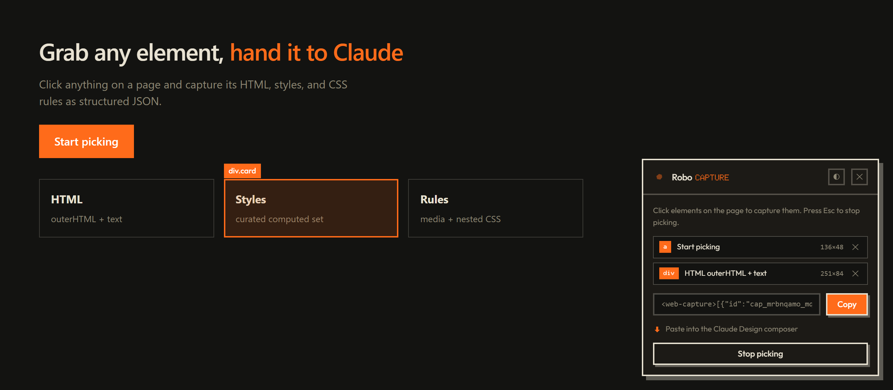

# yravgCapture

Chrome extension to hand a page to an AI agent. Same moves as the **Annotate** menu in Orca's browser, plus the original Robo Capture.

| Mode | Shortcut | What you get |
|---|---|---|
| **Annotate page element** | Alt+Shift+N | Click an element, type feedback, repeat. **Copy** puts all notes on the clipboard as Orca's "Design Feedback" Markdown. |
| **Grab page element** | Alt+Shift+G | Click an element. Orca's "Attached browser context" text is copied at once. |
| **Draw on screenshot** | Alt+Shift+D | Snapshot of the visible tab, mark it with pen or box, copy as PNG or save. |
| **Robo Capture** | - | The original picker: `<web-capture>` JSON for Claude Design. |

Right-click while grabbing opens the note box too. Esc cancels. The bar remembers your last mode.

## Install
1. Clone this repo.
2. `chrome://extensions` -> Developer mode -> **Load unpacked** -> pick the `extension/` folder.
3. Click the toolbar icon. Shortcuts can be changed at `chrome://extensions/shortcuts`.

Does nothing until you click the icon (`activeTab`, no host permissions). Won't run on `chrome://` pages or the Web Store.

## Stays in sync with Orca
The element picker, overlay, extraction budgets, secret redaction and both text formats are **generated from [stablyai/orca](https://github.com/stablyai/orca)**, not copied by hand.

```bash
node scripts/sync-orca.mjs           # pull latest Orca main, rebuild extension/vendor/*
node scripts/sync-orca.mjs --check   # exit 1 when Orca has moved
node scripts/test.mjs                # parse + formatter checks
```

- `upstream/orca/` holds the verbatim upstream files, `upstream/ORCA_SYNC.json` the pinned commit and file hashes.
- A weekly GitHub Action (`.github/workflows/sync-orca.yml`) runs the sync and opens a PR when upstream changed. Reload the extension after merging.
- If Orca refactors a file we extract from, the sync fails loudly (`upstream moved: ...`) instead of shipping a broken build.
- Draw is local code: Orca's markup editor is React and cannot be generated. It stays small on purpose.

Needs Node 22.13+ for `node:module` `stripTypeScriptTypes` (CI uses 24).

## Skill
`skills/yravg-capture/SKILL.md` teaches Claude to read the pasted output and to run the sync. Copy the folder into `~/.claude/skills/`.

## Notes
- Page code runs in the MAIN world to read React fibers (component names, source file), the same way Orca's guest script does. A hostile page could forge its own capture result; the output is only your clipboard.
- Cross-origin iframes are not entered.

## Licenses
MIT for this repo. Annotate/Grab engine: (c) stablyai/orca, MIT. Robo Capture picker (`extension/robo.js`, fonts): CC BY 4.0, created by Jay from RoboLabs ([RoboNuggets](https://robonuggets.com)); see `NOTICE-robo-capture.txt`.
